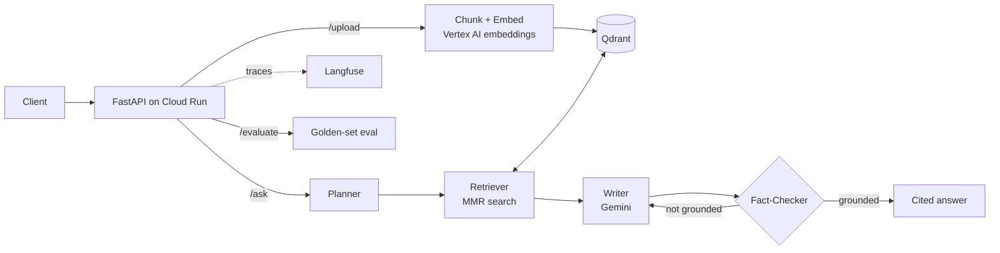

# ResearchPilot: Multi-Agent RAG Assistant on Google Cloud

Upload PDFs or text files and ask questions. A team of LangGraph agents plans the search,
retrieves evidence, writes a cited answer, and a fact-checker rejects ungrounded answers
and sends them back for revision.

## Architecture



## Tech stack

| Area | Tools |
|---|---|
| API | Python, FastAPI, Pydantic, API-key auth |
| RAG + embeddings | LangChain loaders/splitters, Vertex AI `text-embedding-005`, MMR retrieval |
| Vector database | Qdrant (local disk for dev, Qdrant Cloud for prod) |
| Orchestration | LangChain + LangGraph (stateful graph with retry loop) |
| Multi-agent | Planner, Retriever, Writer, Fact-Checker |
| Cloud / LLM | Google Cloud Run, Vertex AI (Gemini), Secret Manager |
| Evaluation + monitoring | LLM-judge faithfulness, keyword recall, grounded rate, latency; `/metrics`; Langfuse tracing |
| Deployment | Docker, GitHub Actions CI/CD, Cloud Run |

## Quick start

```bash
git clone https://github.com/Gunasaiteja/researchpilot && cd researchpilot
python -m venv .venv && source .venv/bin/activate
pip install -r requirements.txt
cp .env.example .env            # fill in GCP_PROJECT and API_KEY
gcloud auth application-default login
uvicorn app.main:app --reload
```

Open http://localhost:8000/docs.

```bash
curl -X POST localhost:8000/upload -H "x-api-key: change-me" -F "file=@paper.pdf"
curl -X POST localhost:8000/ask -H "x-api-key: change-me" \
     -H "Content-Type: application/json" -d '{"question":"What is the main contribution?"}'
```

## Evaluation

1. Edit `eval/golden_set.json` with questions and expected keywords for your documents.
2. Run `python -m app.evaluation` or call `POST /evaluate`.

Record your results here:

| Metric | Result |
|---|---|
| Avg faithfulness | _fill in_ |
| Keyword recall | _fill in_ |
| Grounded rate | _fill in_ |
| Avg latency | _fill in_ |

## Deploy to Cloud Run

```bash
gcloud services enable run.googleapis.com aiplatform.googleapis.com secretmanager.googleapis.com
echo -n "your-key" | gcloud secrets create researchpilot-api-key --data-file=-
gcloud run deploy researchpilot --source . --region us-central1 \
  --set-env-vars GCP_PROJECT=<id>,QDRANT_URL=<qdrant-cloud-url> \
  --set-secrets API_KEY=researchpilot-api-key:latest
```

Cloud Run's disk is ephemeral, so use a hosted Qdrant (`QDRANT_URL`) in production.
The Cloud Run service account needs the **Vertex AI User** role.
For CI/CD, add `GCP_SA_KEY`, `GCP_PROJECT` and `QDRANT_URL` as GitHub secrets.

## Tests

```bash
pytest -q
```

## Project layout

```
app/
  main.py         FastAPI routes, auth, metrics middleware
  graph.py        LangGraph multi-agent workflow
  ingest.py       load, chunk, embed, store
  vectorstore.py  Qdrant setup
  llm.py          Vertex AI Gemini + embeddings, Langfuse callback
  evaluation.py   golden-set evaluation
eval/golden_set.json
tests/test_api.py
Dockerfile
.github/workflows/deploy.yml
```

## Future work

Cross-encoder reranking, streaming responses, per-user document isolation, a React front end.
